# Interactions, state machines and transaction boundaries

All 19 requested interaction families are represented below; additional identity/document/RAG/zone/maintenance interactions were discovered. [interactions.json](../../../output/proofloop-project-wide-audit-2026-10-11/interactions.json) binds each to feature/source IDs and replay inputs. The graph [static-dependency-graph.json](../../../output/proofloop-project-wide-audit-2026-10-11/static-dependency-graph.json) and per-route callTrace in [entrypoint-coverage.json](../../../output/proofloop-project-wide-audit-2026-10-11/entrypoint-coverage.json) retain resolved actual handlers/services. Static callbacks/aliases and deployment edges remain partial.

```mermaid
flowchart LR
 Customer[Customer web / WhatsApp] --> Auth[Clerk and ownership]
 Auth --> Quote[Server quote / pricing / routes]
 Quote --> Booking[Booking and advance]
 Provider[Razorpay raw webhook] --> Booking
 Booking --> Dispatch[Offers / eligibility / capacity]
 GPS[Observed GPS / routing / commitments] --> Dispatch
 Dispatch --> Captain[Captain accept / milestones]
 Captain --> Cancel[Cancel / late recovery / replacement]
 Captain --> Complete[Completion / settlement]
 Cancel --> Refund[Refund / reconciliation]
 Cancel --> Incident[Immutable incident / evidence]
 Incident --> Model[Frozen V5 advisory analysis]
 Model --> Guard[Independent deterministic gate]
 Guard --> Human[Notice / appeal / human authority]
 Human --> Final[Immutable final lineage]
 Final --> Ledger[Liability / compensation / strikes]
 Complete --> Ledger
 Ledger --> Payout[Controlled earnings / RazorpayX payout]
```

An arrow is an interaction obligation, not proof every branch or unsupported family is implemented. Operational recovery and refund do not wait for adjudication. Unsupported detectors/consequences remain blocked, and deployed shadow permission is not inferred from offline guarded analysis.

| ID / composition | Invariant | Failure scenario / replay inputs |
| --- | --- | --- |
| I-01 Booking × pricing (BK-01,FN-01,FN-15) | Signed route/class/add-on base must match stored economics | Stale quote plus zone update; different client/server price basis; capture Quote bytes/version, class/route/add-ons, customer confirmation, clock |
| I-02 Booking × payment × capture (BK-03,FN-04) | One authoritative capture and corresponding booking/advance obligation | Capture before order response or after cancel/timeout; duplicate different provider events; capture Payment purpose/amount/currency/key, raw signed bytes, provider snapshots, before/after DB state |
| I-03 Booking × assignment × eligibility (DS-06,DS-07,DR-04,DR-06) | Current owner/class/capacity/doc/payout/block contract at every actual claim | Generic acceptance bypasses owned-offer callback; approval changes after preflight; capture Owned offer/driver/vehicle/booking, document/destination versions, transaction barrier, auth |
| I-04 Scheduling × GPS × ETA × commitments (DS-02,DS-03,GP-01,GP-03) | Physically feasible timing must use approved policy; unknown remains unassessed | Spatially near but impossible future commitment; old observation/new receipt; delayed sweep; capture Observed/received time, route request/response/traffic/cache identity, whole commitment chain |
| I-05 Assignment × cancellation × replacement (CN-03,CN-05,CN-06) | One current captain; previous owner incident and independent replacement economics | Arrival/accept/late-cancel race; multiple consecutive cancellations; capture Frozen pickup promise, owner/cycle/offer/event identities, ordered DB commit barrier |
| I-06 Replacement × deposits × wallet (CN-06,FN-09,FN-08) | Original owner reservation retained until terminal; every owner gets own release | Legacy booking key reused or release to current driver; capture All ledger keys/owners/amounts, reservation handoff and terminal state |
| I-07 Cancellation × refund × provider reconciliation (CN-01,CN-02,FN-05,FN-06) | Confirmed capped fee, refund balance and monotone owned external outcome | Lost refund response; late failure/processed; capture concurrent with cancel; capture Evidence snapshot/confirmed amount, refund identity, raw events and provider history |
| I-08 Completion × settlement × commission (BK-07,FN-01,FN-02,FN-07) | Gross/base/coupon/advance/compensation/commission sources reconcile once | Duplicate terminal action, unmatched share repricing, loyalty exception; capture Stored historical bases, reward/ledger snapshots, terminal CAS and provider/cash state |
| I-09 Compensation × controlled earnings × payout (RS-05,FN-07,FN-10,FN-11) | Final-only liability; FIFO entitlement; gross intact; recover at most once | Cash delays recovery; destination/earnings change during payout; duplicate recovery; capture Final/evidence IDs, entitlement allocations, earning keys, destination version and provider key |
| I-10 Responsibility evidence × guard × admin authority (RS-01,RS-02,RS-04,RS-07) | Raw model result cannot independently become final/money/strike | Missing evidence, stale review, wrong role, worker crash/resume; capture Immutable evidence/hash, frozen config, raw/gated analysis, signed actor, lease and final lineage |
| I-11 Reliability blocks × new work (RS-06,DR-07,DS-06) | Upheld current block prevents new work while accepted-work recovery remains separate | Block added after offer; expiry/indefinite removal races accept; capture Block/strike/final IDs, clock, auth, locked driver and pending offers |
| I-12 Search extraction × Places × form (AI-01,AI-02,AI-03,AI-05) | Grounded selected detail and explicit form final confirmation; no model submission authority | Stale form revision, invalid detail ID, source-zone/date conflict; capture Original source/spans, trusted edits/revision, provider details/session, final review flags |
| I-13 WhatsApp × identity × booking × payment (WA-01,WA-02,WA-03) | Signed customer intent and durable committed booking must survive message/send failures | Concurrent messages reorder session; create succeeds but confirm handoff fails; capture Raw signed input/message/phone IDs, session revision/step, quote, create outcome and outbound identity |
| I-14 Notifications × state changes × appeal (WA-04,RS-03,DS-09) | Accepted versus delivered is explicit; failed notice starts no appeal clock | Lost alert after claimed send; FCM receipt assumed informed; reordered status; capture Provider acceptance/delivery/receipt clocks, retry key, notice identity and deadline |
| I-15 GPS × arrival × cancellation charge (GP-01,CN-01,BK-08) | Fresh observation/accuracy + verified proximity/reached controls fee and milestones | Buffered location uploaded now; same receipt used as fresh evidence; capture Original device fix/timestamps/accuracy, server clock, calculated distance and decision snapshot |
| I-16 Session/auth × all customer/captain/admin actions (SC-01,SC-02,UI-01,UI-02,UI-03) | Role and object ownership enforced by server despite client state | Expired session, switched actor, protected UI reached through deep link; capture Signed identity/claims, object owner, API response, browser/native navigation state |
| I-17 Workers × DB commit × replay (OP-01,OP-02,RS-07) | DB uniqueness/leases/CAS carry cross-instance correctness, not in-process inFlight | Crash after commit before ack; two workers; late scheduler backlog; capture Clock, ordered task/events, lease owner, transaction phase and complete initial state |
| I-18 Customer × captain × admin applications (UI-01,UI-02,UI-03,CN-06,RS-04) | Same booking/reference/owner/money/evidence after refresh and role changes | One screen stale after replacement; review finality shown before server commit; capture Actor-bound app/API/source identities, UI actions/time, ordered outcomes and final DB/provider histories |
| I-19 Payout destination × identity deletion/re-registration (DR-08,FN-10,RS-05) | Persistent financial identity and valid accepted-payment option survive edits/deactivation | Sentinel deletion preserves ledger but new registration detaches identity; capture Original/superseding identity/destination, liability and accepted-ride snapshots |
| I-20 Documents × scanner × cloud queue × existing work (DR-02,DR-03,DR-04,DR-07,OP-02) | Owned clean/current/valid documents, atomic replacement, safe accepted-work recovery | Late obsolete scan approval; expired cache; killed task; switched vehicle; capture Object byte hash/owner/slot/revision/expiry, task/claim/scan/review and active booking state |
| I-21 Policy corpus × RAG × legal disclosures (EX-01,LG-01,UI-04) | Retrieved original approved/draft/pending passage status preserved; model not policy authority | Wrong audience; contradictory version; partial vector replacement; capture Document/version/chunk/content hash, audience, model selection IDs and rendered source |
| I-22 Admin fare zones × safe route × quote/caches (FN-15,GP-04,BK-01) | Versioned route/zone choice and actual available surcharge bind quote | Concurrent admin edit creates stale cache or silently drops selected route; capture Zone/cache/source version, route verdict/provenance, signature and user selection |
| I-23 Maintenance cleanup × cascade × liabilities/privacy (OP-06,SC-06,DR-08) | Owned maintenance scope must not destroy foreign/financial evidence | Synthetic phone collides; remote runtime DB; cascading delete with immutable histories; capture Owned disposable DB identity, intended record IDs, dry-run/commit boundary and cascade audit |

## Booking edges

Schema states: pending, payment_pending, confirmed, assigned, en_route, reached, started, completed, cancelled, no_driver ([backend/prisma/schema.prisma:9](../../../backend/prisma/schema.prisma#L9)). Completion/milestone transitions are en_route←assigned, reached←assigned/en_route, started←reached, completed←started ([backend/services/rideSettlement.js:14](../../../backend/services/rideSettlement.js#L14)). Customer cancellation uses owned current-state CAS in permitted pre-start states; captain cancellation assigned/en_route/reached returns scheduled→confirmed and immediate→pending, with owner/capacity/evidence writes in the transaction. Capture confirmation, no-driver timeout and refund effects have separate handlers/writers.

The complementary AST register contains 29 actual Booking write sites, including DYNAMIC/UNCHANGED entries; it does not falsely convert status predicates into state-machine edges. Legal/illegal edge assertions must consider every writer, actor and money effect. A status enum alone is not transition enforcement. See [complementary-discovery.json](../../../output/proofloop-project-wide-audit-2026-10-11/complementary-discovery.json) bookingWrites and [entrypoint-coverage.json](../../../output/proofloop-project-wide-audit-2026-10-11/entrypoint-coverage.json) writer/model registries.

## Important commit boundaries

- Assignment reads route/readiness before the claim transaction; claim then locks/rechecks driver, CASes booking, conditionally consumes capacity and invokes owned-offer/deposit callback. The alternate generic route omits that callback. Test the actual wrapper, not only the shared CAS helper.
- Customer/captain cancellation joins ownership, capacity, held-money and immutable incident writes. Evidence failure must roll back the transition. External refund/redispatch/send acknowledgement is a later boundary.
- Payment/provider reconciliation must lock/reload identity and preserve terminal semantics. An event-ID unique key alone cannot protect different provider events with the same meaning.
- Payout preflight validates current balance/destination before external create; application provider-state/ledger writes happen afterwards. Stable idempotency key reduces duplicates but does not alone prove race-safe reservation or destination validity.
- WhatsApp shared booking creation, session update and outbound send are separate steps. Inline ordered messages within one webhook do not establish ordering across simultaneous deliveries for the same phone.
- Scheduler inFlight is process-local; distributed leases/constraints are the safety boundary. Scheduled unfilled query excludes bookings already past pickup. Owner alert is stamped before send; reminder failure instead attempts guarded stamp reset. These are different retry contracts requiring explicit operational review.
